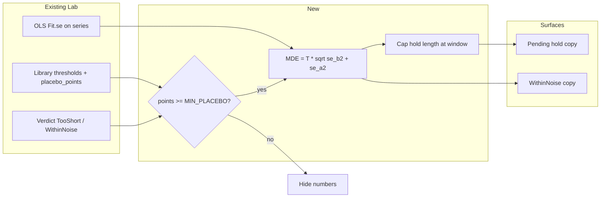

# feat: Evolution Lab detectability / information-cost planner

## Goal Capsule

**Objective:** When the player cannot yet tell whether a settings change helped (or the Lab says the change sits inside noise), they can see how large an effect their current hold could have flagged, and how holding longer would lower that floor — so “wait” and “can’t tell” feel like information trade-offs, not dead ends.

**Means:** Invert the existing placebo-calibrated |z| threshold and OLS standard errors into a minimum detectable slope change (extrapolating future after-side noise per KTD6), gated until placebo calibration is thick enough; surface it via lab-crate formatters on pending after-short holds and WithinNoise verdicts (KTD1–KTD7).

**Authority:** Product Contract → Planning Contract → Implementation Units. Prefer existing verdict maths over new statistical frameworks.

**Stop when:** Forward + retrospective copy ships behind the thick-library gate, window-capped, measure-aware, with tests; no disk writes added.

**Who finishes:** Implementer via `ce-work` or manual; ship with Lab test suite green.

## Product Contract

### Summary

Add an information-cost surface to Evolution Lab: detectability numbers for pending holds and WithinNoise outcomes, following the Lab’s per-change judgment measure (score vs lap slope — not the overview Lap/Rate selector), hidden until placebo points meet `MIN_PLACEBO`.

### Problem Frame

Most changes never earn a Helped/Hurt verdict because holds are short (median ~4 gens) or effects sit inside placebo noise. Today “k more gens” and “within noise” do not say what size of effect was or would be detectable, so players keep fiddling without a reason to hold.

### Requirements

- R1. For a pending change that is TooShort only on the **after** side, when placebo calibration for that change’s measure is thick enough, show the minimum detectable effect at the current after length and at least one longer hold (up to the verdict window).
- R2. For a WithinNoise verdict, when calibration for that verdict’s measure is thick enough, explain about how large a change would have needed to be to be flagged, given the before/after windows used (honest “would not have been flagged” wording — not that smaller effects are impossible).
- R3. Detectability always uses the same measure the Lab would (or did) use to judge that change: lap slope for same-track reward changes; median-score slope otherwise. Do not follow the overview/advice Lap-vs-Rate selector unless it coincides with that rule.
- R4. Detectability numbers must not appear when the relevant placebo point count is below `MIN_PLACEBO` (50). Do not display values derived from `FALLBACK_THRESHOLD`.
- R5. Forward “more gens → smaller effect” must not claim gains past `Library.window` (each side of a verdict is window-capped). If the after side is already at the window, say waiting longer will not improve detectability for this verdict shape.
- R6. Evaluate-only: no new filesystem writes; keeper remains the sole write path.
- R7. Keep existing timing advice prefix “These settings…” where tests assert it; extend copy rather than replacing the contract.

### Actors

- A1. Player training in-game with Lab open on Now training / network timeline.
- A2. Implementer extending `src/lab` + `gui_lab` + `tests/lab.rs`.

### Key Flows

- F1. Pending hold: last verdict is TooShort with adequate before side and short after side → header / timing advice may show detectability (R1, R3–R5). Short-before (or other preconditions that will not yield Helped/Hurt) keep today’s wait copy without a price list.
- F2. WithinNoise tooltip / run-table cell → retrospective detectability (R2–R4).
- F3. Thin library (`placebo_points` / `lap_placebo_points` &lt; 50) → no new detectability figures; existing wait / within-noise / ±T footnotes stay as today (deferred tightening of fallback ±T footnotes is out of this plan’s success bar).

### Acceptance Examples

- AE1. Thick library (≥50 points on the judgment measure): pending after-short run shows an MDE in that measure and at least one longer-hold row within `window` (via truncated-clone fixture if needed).
- AE2. Same: WithinNoise path states about how large a change would have needed to be to be flagged, using stored fits / threshold for that measure.
- AE3. Library with overridden `placebo_points` / `lap_placebo_points` below 50: no detectability figures on either surface.
- AE4. After side already at `window`: forward surface states that waiting longer will not improve detectability for this verdict shape (explicit line, not silence).

### Success Criteria

- Players can answer “what am I buying by holding?” when numbers are honest.
- Thin libraries never show new detectability figures derived from the fallback threshold.
- Spec behaviour goal (longer median holds) is supported without new game hooks.

### Scope Boundaries

**In scope:** Detectability maths; TooShort forward surfaces; WithinNoise retrospective surfaces; tests; measure/gate/window rules above.

**Out of scope:** One-headline timing resolver; Fork duel; Swap card; CantTell theatre redesign; changing placebo calibration itself; clipboard sharing; disk exports.

**Deferred:** Optional later tightening of other UI strings that print ±T while still on fallback (existing “clear above ±T” notes) — decide in U3 only if touch is free; not required for AE1–AE4.

### Key Decisions

- KD1. Ship both forward and retrospective in one plan. (session-settled: user-directed — chosen over hold-only first: ideation included both; user confirmed “both”)
- KD2. Follow the Lab’s per-change judgment measure, not a lap-only shortcut. (session-settled: user-directed — chosen over always lap %)
- KD3. Hide until thick enough; never show fallback-threshold numbers. (session-settled: user-directed — chosen over always labelling default noise)

### Sources

- `.docs/ideation/2026-10-18-evolution-lab-additions-ideation.html` (idea: Detectability / information-cost planner)
- `.docs/evolution-lab-spec.md` (median run length success metric; evaluate-only)
- Repo research scratch `ce-plan-research/efabcbe7/repo-research.md` (not committed)

### Product Contract preservation

Product Contract created by `ce-plan-bootstrap` from ideation + session-settled scope; no prior brainstorm file.

## Planning Contract

### Key Technical Decisions

- KTD1. **MDE formula:** `mde = threshold * sqrt(se_b² + se_a²)` using the Lab’s placebo threshold for that measure (`Library.threshold` or `lap_threshold`), not a fixed 1.96. Convert slope-Δ into player-facing units as a short label (e.g. change in median score or lap per generation × 10 gens) consistent with existing verdict language. (Implements KD2–KD3)
- KTD2. **Thickness gate:** Show numbers only when `placebo_points >= MIN_PLACEBO` (score path) or `lap_placebo_points >= MIN_PLACEBO` (lap path). Never gate by comparing threshold ≈ 4.4 (fixture can calibrate to ~4.40 with ≥50 points).
- KTD3. **Pending measure derivation:** Pending TooShort verdicts currently leave `by_lap == false`. Derive planned measure from the same rules as `verdicts()` (`a.rewards != b.rewards` → lap; else score; both available from `n.runs`). Recompute OLS on the appropriate series (`lap_series` for lap, `medians` for score); `medians` may need to become `pub(crate)` or a shared helper.
- KTD4. **Window honesty:** Cap forward projections at `Library.window`. Waiting only helps when the **after** side is short; a short **before** side cannot be fixed by holding — do not offer a false price list in that case.
- KTD5. **UI attachment points:** Extend header “k more gens” (`gui_lab`), advice timing note (`advice` — keep “These settings…”), and WithinNoise path in `verdict_tooltip` / run-table cell. Prefer one shared formatter for detectability copy. The formatter must live in the `lab` library crate (not `gui_lab.rs`) — see KTD7.
- KTD6. **Forward projection is extrapolation, not re-fitting** *(feasibility correction)*. Generations beyond the current end do not exist, so “rebuild series at projected lengths and recompute OLS” is impossible. Project the after-side standard error instead: with `sxx(n) = n(n²−1)/12` and the current after fit’s variance-inflation factor `k = se·√sxx(n)/sd` (this already folds in the lag-1 widening in `ols`), `se_after(n′) ≈ k·sd/√sxx(n′)`; hold `se_before` fixed (so MDE has a floor of `T·se_before`, worth stating in copy). Rules:
  - `ols` returns `None` for n < 3, and fits at n = 3…`min_side`−1 have 1–7 residual d.o.f. while the placebo threshold was calibrated on sides ≥ `min_side`. For n_after < `min_side`, take `sd` and `k` from the **before** fit as the noise proxy (same run history, same settings regime is not guaranteed — label as an estimate, “about”). Use the after-side `sd`/`k` only once n_after ≥ `min_side`.
  - Reference rows: current after length (only when n_after ≥ 3, otherwise omit that row — R1 “current” is satisfied only where a fit exists), `min_side` (first length at which a verdict can be issued), and `window` (cap). “At least one longer hold” in R1/AE1 is met by the `min_side` and/or `window` rows.
  - All forward figures are phrased as estimates; retrospective figures use the stored fits exactly.
- KTD7. **Verdict-precondition replay and testable seam** *(feasibility correction)*.
  - `gens_to_verdict` fires on `last.len() < min_side` alone. The forward planner must instead key off the last run’s verdict (`n.verdicts.last()`, `run == runs.len()−1`, `Reason::TooShort(nb, na, need)`) and require `nb ≥ need`, and return `None` when a hold would not actually produce a verdict: time-limit change inside the before window or already inside the after window (score path checks `limit_changes` only after the TooShort test, so a pending TooShort can later become `TimeLimitChanged`); lap path where `lap_series` cannot reach 80 % lap coverage on either side (would become `RewardsChanged`); track changed (not TooShort anyway). Use `v.n_after` (already time-limit-truncated) as the current after length.
  - `src/gui_lab.rs` is compiled only into the binary (`mod gui_lab` in `main.rs`); `tests/lab.rs` can reach only `track_builder::lab::*`. All copy producers (header fragment, advice fragment, tooltip sentence) must therefore be pure `lab`-crate functions returning `String`/`Option<String>`, with `gui_lab` only calling them.

### High-Level Technical Design

### Assumptions

- Player-facing units can be expressed from slope × 10 gens without inventing a new measure enum beyond score-vs-lap.
- Fixture library already has enough placebo points for positive tests (verified: 96 score points, 60 lap points); thin-library tests override public count fields on `Library` (formatters read counts at display time, so this works). Pending-hold positives need a truncated-clone fixture (U1).
- No external crate needed for the MDE arithmetic.

### Sequencing

U1 (math API) → U2 (forward UI) and U3 (retrospective UI) can proceed in parallel after U1 → U4 (tests) closes gaps if earlier units under-tested.

### Research Notes

- Placebo threshold barely moves with window size; MDE improvement from waiting comes mainly from smaller `se` as side lengths grow, up to `window`.
- `advice.measure` (Lap/Rate) is a different selector than verdict `by_lap` — do not conflate (repo research).

## Implementation Units

### U1. Detectability maths API

**Goal:** Pure functions in a new `src/lab/detectability.rs` module (re-exported from `lab`) that return structured MDE / forward rows plus shared `String` formatters for pending and WithinNoise copy; `gui_lab` only displays.

**Requirements:** R3, R4, R5; KTD1–KTD7

**Dependencies:** None

**Files:**
- Create: `src/lab/detectability.rs`
- Modify: `src/lab/mod.rs` (export)
- Modify: `src/lab/verdict.rs` — `pub(crate)` series helpers (`medians`, etc.) as needed

**Approach:**
1. Implement thickness check per KTD2.
2. Implement MDE from two `Fit`s + threshold (KTD1).
3. For TooShort after-short: build the before series (fixed) and current after series from the verdict’s window bounds, fit OLS where n ≥ 3, then project `se_after` at `min_side` and `window` by KTD6 (extrapolation, not re-fitting); return rows of (gens_to_add, mde) with `gens_to_add` ≤ `window − n_after`. Apply the KTD7 precondition replay first.
4. For WithinNoise: use stored `before`/`after` fits when present; return retrospective MDE only (`by_lap` selects `lap_threshold` / `lap_placebo_points`).
5. Short-before and other KTD7 failures return `None` for the forward planner (KTD4).
6. Shared formatters live in this module (KTD7). At-window case returns an explicit “waiting longer will not improve detectability” string (R5/AE4), not an empty list. Retrospective copy: “a change smaller than about X per 10 gens would not have been flagged”.

**Patterns to follow:** `ols` / `slope_change` / `lap_slope_change` in `verdict.rs`; separate score vs lap thresholds on `Library`.

**Test scenarios:**
- Happy: two synthetic fits + T → MDE equals `T * sqrt(se_b²+se_a²)` within float tolerance.
- Edge: points &lt; 50 → `None`.
- Edge: after length == window → explicit “won’t improve” formatter output (not silence).
- Edge: short before, long after → forward `None`.
- Measure: reward-change series uses lap path and `lap_threshold` / `lap_placebo_points`.
- Edge: n_after < 3 → no “current” row, forward rows still produced from before-fit noise proxy; projected MDE is monotonically non-increasing in n and floors at `T·se_before`.
- Edge: pending verdict whose after window already contains a time-limit change, or lap path without 80 % lap coverage → `None`.
- Fixtures: no fixture network currently has a pending hold (`gens_to_verdict` is `None` for all; “Type 2” / “Type 2.1” last verdicts are short-**before**: TooShort(4,20,10) / (1,20,10)). Positive forward tests must build a truncated clone, e.g. clone `Faster again 3`’s `Save`, truncate `gens` to `1208 + 5` (reward-change run, lap path, before = 20) and run `library::analyse`; assert `lap_placebo_points ≥ 50` still holds after truncation (60 on the full fixture, so close to the gate) and otherwise pick a score-path change. Fixture WithinNoise verdicts with fits: “Type 2.2” gen 528 (score, 20/14), “Faster again 3” gens 1092 and 1208 (lap).

**Verification:** Unit tests in `tests/lab.rs` or `verdict` module tests; `cargo test --test lab` for touched cases.

### U2. Forward planner on pending holds

**Goal:** Surface detectability on TooShort-after pending holds in header and timing advice without breaking existing string contracts.

**Requirements:** R1, R3, R4, R5, R6, R7; KTD5–KTD7; KD1

**Dependencies:** U1

**Files:**
- Modify: `src/gui_lab.rs` (header gens-to-verdict region ~486; call the lab-crate formatter only)
- Modify: `src/lab/advice.rs` (timing wait note ~178)
- Test: `tests/lab.rs` (assert on `advice::advise` and the lab-crate formatter; the GUI header string is not reachable from integration tests)

**Approach:**
1. When the last verdict is TooShort-after (KTD7) and U1 returns data, append/format detectability beside existing wait copy (`gens_to_verdict` alone is insufficient).
2. Preserve leading “These settings…” where asserted.
3. If U1 returns `None`, keep today’s copy unchanged.

**Test scenarios:**
- Covers AE1: truncated-clone fixture library (see U1 Fixtures) pending after-short → `advice::advise` timing note and formatter output contain a detectability fragment.
- Covers AE3: overridden thin points → no detectability fragment.
- Covers AE4: after at window → explicit “will not improve detectability” line from the lab-crate formatter.
- Regression: existing timing suggestion prefix test still passes.

**Verification:** `cargo test --test lab`

**Execution note:** Prefer characterization of current wait strings before editing copy.

### U3. Retrospective WithinNoise detectability

**Goal:** Explain about how large a change would have needed to be to be flagged on WithinNoise verdicts when thick enough.

**Requirements:** R2, R4; KTD5; KD1

**Dependencies:** U1

**Files:**
- Modify: `src/gui_lab.rs` (`verdict_tooltip` ~2467 and run-table cell, where WithinNoise falls into the `CantTell(_)` arm ~1104; call the lab-crate formatter only)
- Test: `tests/lab.rs` (assert on the lab-crate formatter; `verdict_tooltip` itself is binary-only and untestable from `tests/`)

**Approach:**
1. On `Outcome::CantTell(WithinNoise)` with fits present and gate open, append MDE sentence via shared formatter from U1.
2. Leave Helped/Hurt/other CantTell reasons unchanged.
3. Optional drive-by: only if already editing threshold footnote nearby, avoid printing fallback T as if calibrated — not required for AEs.

**Test scenarios:**
- Covers AE2: fixture WithinNoise verdicts (score: “Type 2.2” gen 528; lap: “Faster again 3” gens 1092/1208) with thick points → formatter output includes the MDE wording, using `threshold` vs `lap_threshold` per `by_lap`.
- Covers AE3: thin points → wording absent.
- Edge: WithinNoise without fits → no panic; no detectability line.

**Verification:** `cargo test --test lab` plus manual Lab open on fixture if GUI-only path lacks a direct assert.

### U4. Integration coverage and write-fence

**Goal:** Close remaining AE gaps and prove no new disk writes.

**Requirements:** R6; AE1–AE4

**Dependencies:** U2, U3

**Files:**
- Modify: `tests/lab.rs`

**Approach:**
1. Add fixture-based cases spanning forward + retrospective if U2/U3 left holes.
2. Confirm `lab_never_writes_files` still passes with no new `fs::write` sites.

**Test scenarios:**
- Happy: one end-to-end library scan path that exercises U1 through formatted strings for both surfaces.
- Regression: `lab_never_writes_files` green.

**Verification:** `cargo test --test lab`

## Verification Contract

- Primary: `cargo test --test lab`
- Broader if touching shared lab modules: `cargo test`
- Manual: open Lab on a thick save library — pending hold and a WithinNoise verdict show/hide as gated; thin library (or forced low point counts in test) shows no numbers.

## Definition of Done

- R1–R7 satisfied; AE1–AE4 covered by automated tests where feasible.
- No new filesystem writes; evaluate-only preserved.
- Session-settled KD1–KD3 reflected in shipped behaviour (both surfaces, measure-follow, hide-until-thick).
- Plan units U1–U4 complete or explicitly deferred with reason.

## Appendix

### Origin idea (condensed)

From ideation rank 2: turn “wait N gens” into a price list from placebo |z| noise; after WithinNoise, state what size effect was undetectable; support longer holds without new game hooks.
